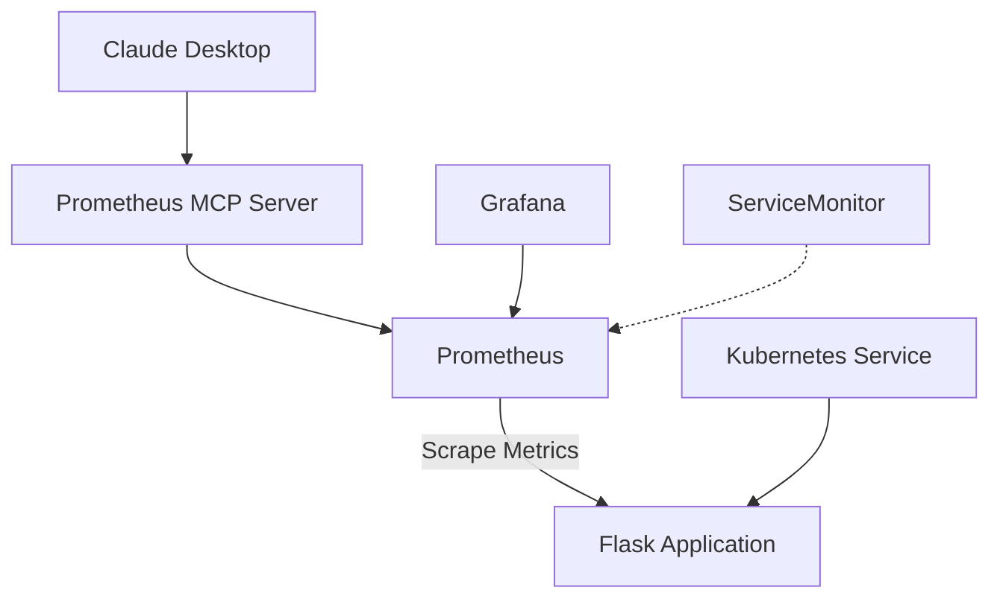

# Kubernetes Monitoring with Prometheus, Grafana and Claude MCP

## Overview

I built this project to monitor a Kubernetes application using Prometheus and Grafana and integrate Claude Desktop through MCP for AI-powered monitoring.

The application is a Python Flask service deployed on Minikube. It exposes HTTP request metrics, response times and errors, which can be monitored through Grafana and queried using Claude.

## Tech Stack

Python, Flask, Docker, Kubernetes, Minikube, Helm, Prometheus, Grafana, PromQL, MCP and Claude Desktop.

## Architecture



## Project Structure

```text
prometheus-ai-monitoring/
├── app/
│   ├── app.py
│   ├── Dockerfile
│   └── requirements.txt
├── kubernetes/
│   ├── deployment.yaml
│   ├── service.yaml
│   └── servicemonitor.yaml
├── grafana/
│   └── kubernetes-monitoring-dashboard.json
├── .gitignore
└── README.md
```

## Setup

### 1. Start Minikube

Start Docker Desktop and run:

```bash
minikube start --driver=docker
```

### 2. Build the Docker image

```bash
docker build -t prometheus-demo:v1 ./app
minikube image load prometheus-demo:v1
```

### 3. Install Prometheus and Grafana

```bash
helm repo add prometheus-community https://prometheus-community.github.io/helm-charts
helm repo update
helm upgrade --install monitoring prometheus-community/kube-prometheus-stack --namespace monitoring --create-namespace
```

### 4. Deploy the application

```bash
kubectl apply -f kubernetes/
kubectl get pods
```

### 5. Port forwarding

Run each command in a separate terminal.

```bash
kubectl port-forward -n default svc/prometheus-demo 5001:5000
```

```bash
kubectl port-forward -n monitoring svc/monitoring-kube-prometheus-prometheus 9090:9090
```

```bash
kubectl port-forward -n monitoring svc/monitoring-grafana 3000:80
```

| Service | URL |
|---|---|
| Application | http://localhost:5001 |
| Prometheus | http://localhost:9090 |
| Grafana | http://localhost:3000 |

## Application Endpoints

| Endpoint | Purpose |
|---|---|
| `/` | Main application |
| `/health` | Health check |
| `/metrics` | Prometheus metrics |
| `/error` | Simulates HTTP 500 errors |

## Prometheus Queries

Application scrape status:

```promql
up{service="prometheus-demo"}
```

Total HTTP requests:

```promql
sum(demo_http_requests_total)
```

HTTP 500 errors:

```promql
sum(demo_http_requests_total{status="500"})
```

Request rate:

```promql
sum(rate(demo_http_requests_total[5m]))
```

## Grafana Dashboard

I created an eight-panel dashboard to monitor application health, request traffic, errors and response times.

Import the dashboard JSON from:

`grafana/kubernetes-monitoring-dashboard.json`

Select Prometheus as the data source during import.

## Claude MCP Integration

I connected Claude Desktop to Prometheus using the Prometheus MCP server.

Add the following configuration to Claude Desktop's local MCP configuration, preserving any existing settings:

```json
{
  "mcpServers": {
    "prometheus": {
      "command": "C:\\path\\to\\prometheus-mcp.exe",
      "args": [
        "--mcp.transport=stdio",
        "--prometheus.url=http://127.0.0.1:9090",
        "--web.listen-address=127.0.0.1:8080"
      ]
    }
  }
}
```

Replace the executable path with your local MCP installation path and restart Claude Desktop.

## Testing

I generated successful requests and intentional HTTP 500 errors using PowerShell.

```powershell
1..100 | ForEach-Object {
    Invoke-WebRequest http://localhost:5001/ -UseBasicParsing | Out-Null
}
```

```powershell
1..10 | ForEach-Object {
    try {
        Invoke-WebRequest http://localhost:5001/error -UseBasicParsing | Out-Null
    } catch {}
}
```

## AI Monitoring Results

I tested the MCP integration by asking Claude to check application health, analyze latency and investigate HTTP errors.

| Metric | Observed Result |
|---|---|
| Prometheus scrape status | UP |
| Total HTTP requests | 568 |
| HTTP 500 errors | 10 |
| Error percentage | 1.76% |
| Average response time | 0.0995 ms |
| Estimated P95 latency | 4.75 ms |

Claude identified `/error` as the source of all 10 HTTP 500 responses, which matched the intentional error traffic.

These results are from different testing snapshots and may change with application traffic. P95 latency is a histogram-based estimate.

## Example Claude Prompts

- Check whether Prometheus is scraping my application.
- How many HTTP 500 errors has my application recorded?
- Analyze application health and response times.
- Identify the endpoints causing HTTP 500 errors.

## Environment

Developed and tested on Windows using Docker Desktop, Minikube, PowerShell and Claude Desktop.
